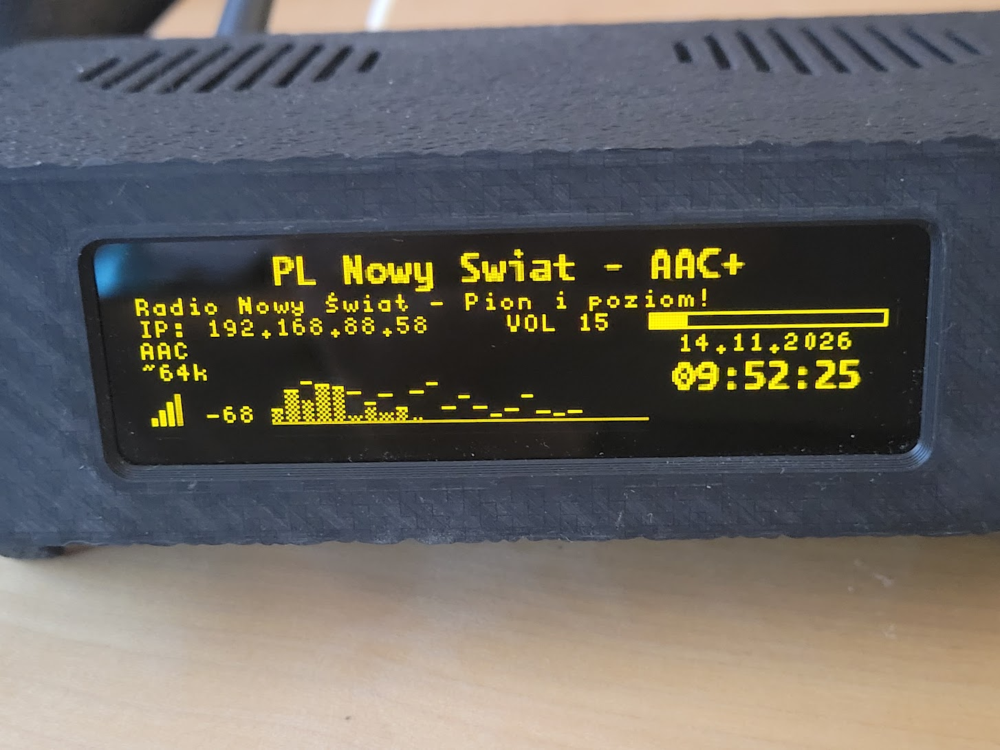
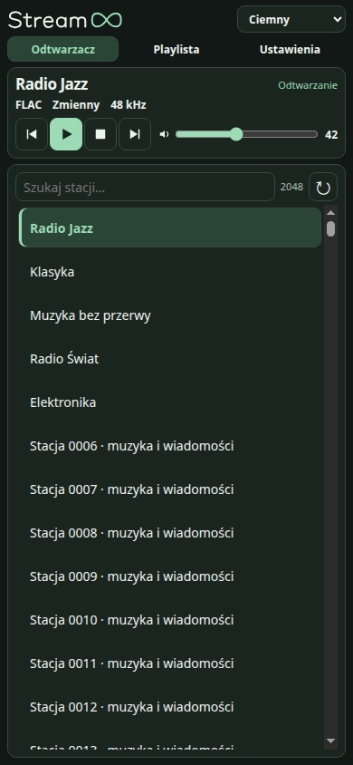

[English version — README_EN.md](README_EN.md) · [Dokumentacja po angielsku](docs/en/00_INDEX.md)

# StreamOO — radio internetowe ESP32-S3

<p align="center">
  
</p>

StreamOO to natywne firmware ESP-IDF dla ESP32-S3-WROOM-1-N16R8,
z wyświetlaczem OLED SSD1322 256×64, przetwornikiem PCM5102A i jednym
enkoderem. Obsługuje radio HTTP/HTTPS, listę stacji, konfigurację Wi-Fi,
panel WWW na komputerze i telefonie oraz cztery wizualizacje dźwięku.

**StreamOO jest projektem rozwojowym o modularnej budowie.** Oddzielne moduły
audio, DSP, wyświetlacza, sterowania, sieci i panelu WWW ułatwiają jego
rozbudowę. Każdy może dostosowywać projekt do własnych potrzeb: zmieniać
konfigurację sprzętu, wygląd interfejsu i dodawać funkcje, zgodnie z
[licencją projektu i warunkami zależności](LICENSING.md).

## Instrukcje

- **[Instrukcja obsługi](docs/USER_GUIDE.md)** — pierwsze uruchomienie,
  enkoder, OLED, panel WWW, playlisty i rozwiązywanie problemów.
- **[Konfiguracja i budowanie](docs/BUILD_GUIDE.md)** — ESP-IDF 6.1,
  prywatne hasło AP, `menuconfig`, GPIO, kompilacja i wgrywanie firmware.
- [Sprzęt i połączenia](docs/02_HARDWARE.md).
- [Indeks dokumentacji](docs/00_INDEX.md), [status prac](docs/STATUS.md)
  i [punkt wznowienia](docs/RESUME.md).

## Bieżące możliwości

- MP3, AAC/HE-AAC, FLAC, Ogg Vorbis/Opus, adresy M3U/PLS oraz ograniczony
  zakres HLS. Zgodność konkretnego strumienia i stabilność na sprzęcie
  wymagają sprawdzenia; granice opisuje [instrukcja obsługi](docs/USER_GUIDE.md#formaty-i-ograniczenia).
- Do 8 zapisanych sieci Wi-Fi; punkt konfiguracji AP, gdy żadna nie działa.
- Do 2048 stacji. Import/eksport formatu yoRadio: UTF-8, trzy pola TAB.
  Import dopisuje stacje do istniejącej listy.
- WWW: przewijana pełna lista i wyszukiwanie, poprzednia/następna stacja,
  PLAY/STOP, głośność podczas przesuwania suwaka, kodek i bitrate,
  motywy systemowy/jasny/ciemny, edytor oraz ustawienia.
- OLED: nazwa stacji, metadane, głośność, zegar i wizualizacje:
  widmo, bargraph L/R, wskazówki L/R, widmo z peak hold.
- Trwałe ustawienia i katalog stacji. Aktualizacje przewodowe, bez OTA.

## Zdjęcie radia i podgląd panelu WWW

Radio z wyświetlaczem OLED i widmem z peak hold:

<p align="center">
  
</p>

Mobilny panel WWW w ciemnym motywie, z przykładową listą stacji:

<p align="center">
  
</p>

## Kodeki i bitrate

| Kodek | Obsługiwany profil / kontener | Bitrate |
|---|---|---|
| MP3 | MPEG Audio Layer III, bezpośredni strumień lub obsługiwany HLS/MPEG-TS | Stały (CBR) i zmienny (VBR) |
| AAC | AAC-LC, HE-AAC (AAC+/SBR), HE-AACv2 (SBR/PS); ADTS lub obsługiwany HLS/MPEG-TS | CBR i VBR, zależnie od źródła |
| FLAC | Natywny strumień FLAC; domyślny dekoder dr_flac | Zmienny, kompresja bezstratna |
| Vorbis | Ogg Vorbis | Zależny od ustawień i zawartości strumienia, także VBR |
| Opus | Ogg Opus | CBR i VBR, zależnie od źródła |

Tor odtwarzania przyjmuje mono/stereo, **8–48 kHz** oraz PCM z dekodera
16/24/32-bit, zależnie od kodeka i wybranego backendu. Wyjście do PCM5102A
to **48 kHz, stereo, I²S w slotach 32-bit**; pozostałe częstotliwości wejściowe
są przeliczane. Nie oznacza to 32-bitowej rozdzielczości każdego źródła.

Nie ustalono jeszcze gwarantowanego maksymalnego bitrate dla każdego kodeka.
Próbki generowane do testów obejmują MP3 **128 kb/s CBR**, AAC-LC z celem
**128 kb/s** i Opus z celem **96 kb/s** — są to parametry próbek, a nie limity
dekoderów. Dla wariantów `EXT-X-STREAM-INF` w HLS wybierane są deklaracje
`BANDWIDTH` do **512 kb/s**; ten filtr nie jest ogólnym limitem radia ani
bezpośrednich strumieni FLAC. Stabilność zależy także od profilu kodeka,
buforowania i dostarczania danych przez sieć.

Panel WWW pokazuje kodek, częstotliwość próbkowania i bitrate w kb/s:
deklarację źródła lub estymację oznaczoną **≈**. Po wykryciu zmienności
pokazuje wyłącznie **„Zmienny”**, bez skaczącej liczby. Estymacja wynika
z ilości skompresowanych danych i czasu audio, a nie z szybkości pobierania.
Wykrycie VBR wymaga kilku okien obserwacji.

## HTTP, HTTPS i playlisty

- **HTTP i HTTPS** dla strumieni, obsługa przekierowań i metadanych ICY.
- Rozwiązywanie adresów playlist **M3U/PLS** oraz ograniczony **HLS**:
  nieszyfrowane segmenty MP3/AAC i MPEG-TS z obsługiwanym audio.
  Szyfrowane segmenty HLS/DRM, fMP4, byte-range i LL-HLS nie są obsługiwane.
- HTTPS sprawdza certyfikat serwera, nazwę hosta i daty ważności przy użyciu
  pakietu CA ESP-IDF. Start czeka na poprawny czas UTC z SNTP;
  radio nie wyłącza weryfikacji ani nie zamienia samoczynnie HTTPS na HTTP.
- Panel sterowania WWW działa lokalnie przez **HTTP**; obsługa HTTPS
  dotyczy połączeń radia do źródeł audio.

## SIMD i sprzętowa kryptografia ESP32-S3

| Obszar | Używana akceleracja |
|---|---|
| FFT analizatora widma | Domyślnie wektorowy kernel **ESP-DSP sc16 AES3**, wykorzystujący instrukcje PIE/SIMD ESP32-S3. Okno Hann, usuwanie DC, skalowanie i agregacja pasm pozostają skalarne. |
| Dekoder Opus | Częściowe SIMD w filtrze LPC ścieżki **SILK**, także przy odtwarzaniu utraconych pakietów (PLC). Zakres użycia zależy od trybu strumienia; nie cały dekoder jest wektorowy. |
| Pozostałe dekodery | Audyt sprawdzonych ścieżek MP3, AAC/HE-AAC, FLAC i Vorbis nie potwierdził arytmetyki SIMD. Domyślny dr_flac pracuje na S3 skalarnie. |
| HTTPS / TLS | Włączone sprzętowe **AES** (szyfrowanie/deszyfrowanie) i **SHA** (funkcje skrótu) ESP32-S3, używane przez stos kryptograficzny ESP-IDF dla obsługiwanych operacji. |

Akceleracja kryptografii jest włączona w profilu domyślnym przez
`CONFIG_MBEDTLS_HARDWARE_AES` i `CONFIG_MBEDTLS_HARDWARE_SHA`.
`CONFIG_STREAMOO_CRYPTO_EARLY_INIT` przygotowuje AES/SHA i zasoby DMA
przed uruchomieniem I²S. Konkretne operacje zależą od uzgodnionego zestawu
szyfrów TLS; procesor nadal obsługuje pozostałą część protokołu.
Sprzętowe AES dla HTTPS nie dodaje obsługi szyfrowanych segmentów HLS.

SIMD FFT wybiera `CONFIG_STREAMOO_DSP_ENABLE_SIMD`; obliczenia odbywają się
w osobnym zadaniu, poza ścieżką wydawania próbek I²S. Nazwa backendu FFT
„AES3” jest niezależna od sprzętowego szyfratora AES. Szczegóły i zakres
potwierdzenia: [audyt SIMD](docs/CODEC_SIMD_AUDIT.md),
[DSP](docs/07_DSP.md) i [przygotowanie kryptografii](docs/adr/0096-early-hardware-crypto-preparation.md).

## Szybki start dla istniejącego środowiska

W aktywnym terminalu **ESP-IDF 6.1**, w katalogu projektu:

```sh
# Tylko przed pierwszym buildem z siecią: utwórz prywatne hasło AP.
python3 tools/configure_network.py
idf.py menuconfig
python3 tools/check_config.py sdkconfig --platform
idf.py reconfigure build
```

W `menuconfig` otwórz **StreamOO Configuration**. Istniejącego poprawnego
`sdkconfig` nie usuwaj: ma pierwszeństwo przed `sdkconfig.defaults`.
Przed pierwszym wgraniem przeczytaj [instrukcję budowania](docs/BUILD_GUIDE.md),
zwłaszcza opis portu, partycji i zachowania zapisanych stacji.
Hasło AP nie jest ustawieniem `menuconfig`; bez prywatnego pliku firmware
może się zbudować, ale sieć pozostanie wyłączona.

## Rozwój i weryfikacja

[Współtworzenie](CONTRIBUTING.md) · [Bezpieczeństwo](SECURITY.md) ·
[Historia zmian](CHANGELOG.md) · [Raport audytu](docs/AUDIT_REPORT.md)

```sh
python3 -m unittest discover -s tests -v
```

Normalny profil ma wyłączone testy sprzętowe i szczegółowe okresowe raporty
UART. [Instrukcja budowania](docs/BUILD_GUIDE.md#diagnostyka-i-testy) opisuje
osobny profil diagnostyczny. Testy hostowe i build nie zastępują odsłuchu,
pomiarów na płytce ani testu zaniku zasilania podczas zapisu.

Przed zmianami przeczytaj [AGENTS.md](AGENTS.md),
[CODEX_MASTER_PROMPT.md](CODEX_MASTER_PROMPT.md) i odpowiedni etap z indeksu.
Implementacja jest niezależna od Arduino; yoRadio jest materiałem
referencyjnym zachowania i formatu playlisty. Historia etapów znajduje się
w dokumentach projektu i [ADR](docs/adr/), a nie w instrukcjach użytkowych.
Zasady metryk commitów: [COMMIT_METRICS.md](docs/COMMIT_METRICS.md).

## Licencja

Własny kod, dokumentacja i oryginalne zasoby StreamOO są udostępniane na
[licencji MIT](LICENSE). Copyright (c) 2026 Mariusz Księżak.
Biblioteki, fonty, dane CA i materiały referencyjne zachowują odrębne warunki:
[zakres i wyjątki](LICENSING.md), [noty zależności](THIRD_PARTY_NOTICES.md),
[teksty licencji](licenses/README.md).

Obecny firmware zawiera kodeki na Espressif Modified MIT, z ograniczeniem
do produktów Espressif. Licencja MIT własnej aplikacji nie usuwa tego warunku.
