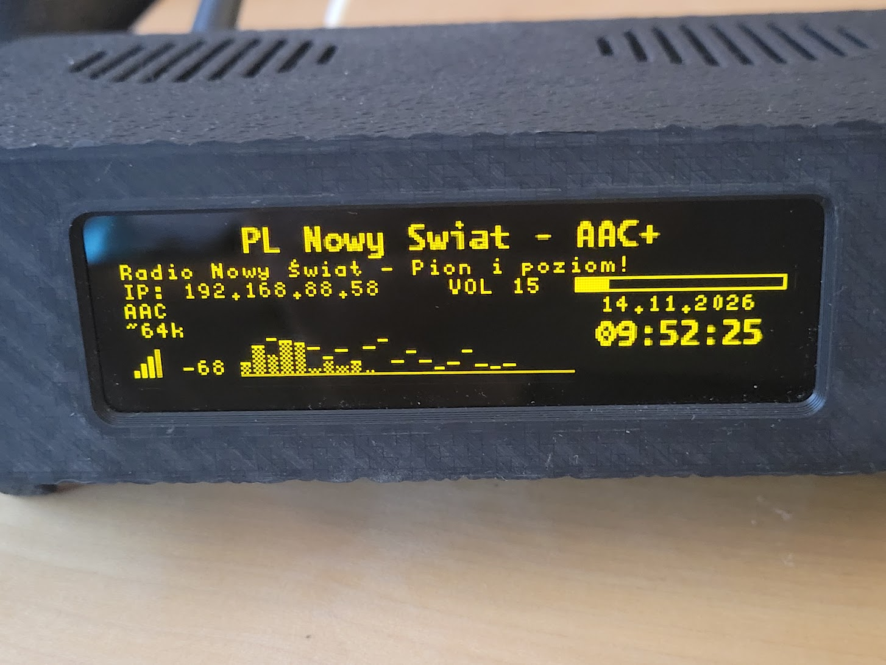
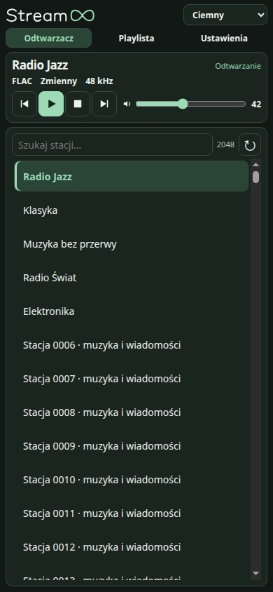

[Polska wersja — README.md](README.md) · [English documentation](docs/en/00_INDEX.md)

# StreamOO — ESP32-S3 Internet Radio

<p align="center">
  
</p>

StreamOO is native ESP-IDF firmware for the ESP32-S3-WROOM-1-N16R8,
with a 256×64 SSD1322 OLED display, a PCM5102A DAC and one rotary encoder.
It provides HTTP/HTTPS Internet radio, a station catalog, Wi-Fi configuration,
a web interface for computers and phones, and four audio visualizations.

**StreamOO is a project under active development with a modular architecture.**
Separate audio, DSP, display, input, network and web interface modules make
it easier to extend. Anyone can adapt the project to their own needs by
changing the hardware configuration, customizing the interface or adding
features, subject to the [project license and dependency terms](LICENSING.md).

## Documentation

The English documentation is in **[docs/en/](docs/en/00_INDEX.md)**.

- **[User guide](docs/en/USER_GUIDE.md)** — first startup, encoder, OLED,
  web player, playlists and troubleshooting.
- **[Configuration and build guide](docs/en/BUILD_GUIDE.md)** — ESP-IDF 6.1,
  private AP password, `menuconfig`, GPIO assignments, building and flashing.
- [Hardware and wiring](docs/en/02_HARDWARE.md).
- [Documentation index](docs/en/00_INDEX.md), [project status](docs/en/STATUS.md)
  and [development handover](docs/en/RESUME.md).

## Current features

- MP3, AAC/HE-AAC, FLAC, Ogg Vorbis/Opus, M3U/PLS URLs and a limited HLS
  implementation. Individual streams and hardware stability need validation;
  see [formats and limitations](docs/en/USER_GUIDE.md#formats-and-limitations).
- Up to eight saved Wi-Fi networks, with a setup access point if none works.
- Up to 2048 stations. Import/export uses the yoRadio UTF-8 format with three
  TAB-separated fields. Import appends stations to the existing catalog.
- Web player: a scrollable full station list, search, previous/next station,
  PLAY/STOP, volume changes while dragging, codec and bitrate information,
  system/light/dark themes, a catalog editor and settings.
- OLED: station name, metadata, volume, clock and four visualizations:
  spectrum, L/R bargraphs, L/R needles, and spectrum with peak hold.
- Persistent settings and station storage. Wired firmware updates; no OTA.

## Radio photo and web interface preview

The radio's OLED display showing the spectrum with peak hold:

<p align="center">
  
</p>

The mobile web interface in dark mode, with an example station list:

<p align="center">
  
</p>

## Codecs and bitrate

| Codec | Supported profile / container | Bitrate |
|---|---|---|
| MP3 | MPEG Audio Layer III, direct streams or supported HLS/MPEG-TS | Constant (CBR) and variable (VBR) |
| AAC | AAC-LC, HE-AAC (AAC+/SBR), HE-AACv2 (SBR/PS); ADTS or supported HLS/MPEG-TS | CBR and VBR, depending on the source |
| FLAC | Native FLAC streams; dr_flac is the default decoder | Variable, lossless compression |
| Vorbis | Ogg Vorbis | Depends on stream settings and content, including VBR |
| Opus | Ogg Opus | CBR and VBR, depending on the source |

The playback pipeline accepts mono/stereo at **8–48 kHz**, with 16/24/32-bit
decoder PCM depending on the codec and selected backend. Output to the PCM5102A
is **48 kHz, stereo, I²S in 32-bit slots**; other input sample rates are
resampled. This does not imply 32-bit resolution for every source.

A guaranteed maximum playback bitrate has not yet been established for each
codec. Generated test fixtures include **128 kb/s CBR** MP3, AAC-LC targeting
**128 kb/s**, and Opus targeting **96 kb/s**. These are fixture parameters,
not decoder limits. HLS `EXT-X-STREAM-INF` selection accepts declared
`BANDWIDTH` values up to **512 kb/s**; this filter is not a general radio limit
or a cap on direct FLAC streams. Stability also depends on the codec profile,
buffering and network delivery.

The web panel shows the codec, sample rate and bitrate in kb/s: a source
declaration or an estimate marked **≈**. Once variation is detected, it shows
only **“Zmienny” (Variable)** without a fluctuating number. The estimate uses
compressed bytes and audio duration, not download speed. VBR detection needs
several observation windows.

## HTTP, HTTPS and playlists

- **HTTP and HTTPS** streams, with redirects and ICY metadata support.
- **M3U/PLS** playlist URL resolution and a limited **HLS** implementation:
  unencrypted MP3/AAC segments and MPEG-TS carrying supported audio.
  Encrypted HLS segments/DRM, fMP4, byte-range and LL-HLS are unsupported.
- HTTPS checks the server certificate, hostname and validity dates using
  the ESP-IDF CA bundle. Startup waits for valid UTC from SNTP; the radio
  does not disable verification or automatically downgrade HTTPS to HTTP.
- The local web control panel uses **HTTP**; HTTPS support applies to
  outgoing connections from the radio to audio sources.

## ESP32-S3 SIMD and hardware cryptography

| Area | Acceleration used |
|---|---|
| Spectrum analyzer FFT | The default **ESP-DSP sc16 AES3** vector kernel uses ESP32-S3 PIE/SIMD instructions. Hann windowing, DC removal, scaling and band aggregation remain scalar. |
| Opus decoder | Partial SIMD in the **SILK** LPC filter, also used during packet loss concealment (PLC). Usage depends on the stream mode; the entire decoder is not vectorized. |
| Other decoders | Audited MP3, AAC/HE-AAC, FLAC and Vorbis paths did not show confirmed SIMD arithmetic. The default dr_flac backend runs scalar code on the S3. |
| HTTPS / TLS | ESP32-S3 hardware **AES** (encryption/decryption) and **SHA** (hashing) are enabled and used by the ESP-IDF cryptography stack for supported operations. |

The default profile enables cryptographic acceleration through
`CONFIG_MBEDTLS_HARDWARE_AES` and `CONFIG_MBEDTLS_HARDWARE_SHA`.
`CONFIG_STREAMOO_CRYPTO_EARLY_INIT` prepares AES/SHA and DMA resources before
starting I²S. Actual operations depend on the negotiated TLS cipher suite;
the CPU still handles the remaining protocol work. Hardware AES for HTTPS
does not add support for encrypted HLS segments.

`CONFIG_STREAMOO_DSP_ENABLE_SIMD` selects the vector FFT, which runs in a
separate task outside the I²S sample output path. The FFT backend name “AES3”
is independent of the AES encryption peripheral. See the English
[DSP documentation](docs/en/07_DSP.md), [audio documentation](docs/en/06_AUDIO.md)
and [TLS documentation](docs/en/09_NETWORK.md). The detailed
[SIMD audit and evidence](docs/CODEC_SIMD_AUDIT.md) are in Polish.

## Quick start with an existing development environment

In an activated **ESP-IDF 6.1** terminal, from the project root:

```sh
# Only before the first network-enabled build: create the private AP password.
python3 tools/configure_network.py
idf.py menuconfig
python3 tools/check_config.py sdkconfig --platform
idf.py reconfigure build
```

Open **StreamOO Configuration** in `menuconfig`. Keep an existing valid
`sdkconfig`: its values take precedence over `sdkconfig.defaults`.
Before flashing for the first time, read the [build guide](docs/en/BUILD_GUIDE.md),
especially the port, partition and saved-data instructions. The AP password
is not a `menuconfig` setting. Firmware can build without the private file,
but networking will remain disabled.

## Development and validation

[Contributing](CONTRIBUTING.md) · [Security](SECURITY.md) ·
[Changelog](CHANGELOG.md) · [Repository audit](docs/AUDIT_REPORT.md)

```sh
python3 -m unittest discover -s tests -v
```

The normal profile disables hardware test sources and detailed periodic UART
reports. The [build guide](docs/en/BUILD_GUIDE.md#diagnostics-and-tests) describes
a separate diagnostic profile. Host tests and a successful build do not replace
listening tests, board measurements or power-loss testing during writes.

Before changing the project, read the repository's [agent rules](AGENTS.md),
[master brief](CODEX_MASTER_PROMPT.md) and the relevant stage in the index.
The implementation is independent of Arduino. yoRadio is a behavioral and
playlist-format reference. Development history is kept in project records
and ADRs. See the English [contribution guidance](docs/en/CONTRIBUTING.md)
for the workflow and verified commit-metric policy.

## License

Original StreamOO code, documentation and artwork are available under the
[MIT License](LICENSE). Copyright (c) 2026 Mariusz Księżak.
Libraries, fonts, CA data and reference materials keep their own terms:
[scope and exceptions](LICENSING.md), [third-party notices](THIRD_PARTY_NOTICES.md)
and [retained license texts](licenses/README.md).

The current firmware includes codecs under Espressif Modified MIT, which
restricts their use to Espressif products. The application's MIT license
does not remove that condition.
