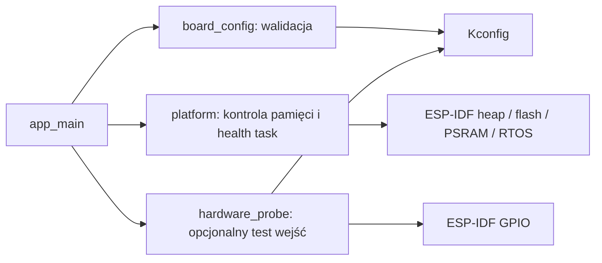

# 03 — Platforma, architektura i zasoby

Aktualna procedura instalacji środowiska, budowania i flashowania:
[BUILD_GUIDE.md](BUILD_GUIDE.md). Opisy pierwszych etapów niżej są historyczne;
w bieżącej implementacji działają już właściciele stanów player/network/UI.

Aktualny audyt internal/PSRAM i stosów: [MEMORY_AUDIT](MEMORY_AUDIT.md),
ADR0098. Domyślne źródła testowe wyłączone:9792B mniej stałego DRAM,
bez zmniejszenia stosów, PCM lub TCP. Runtime heap po zmianie OPEN.

ADR0096: opcjonalny boot-only probe crypto przed audio/siecią zajmuje
sprzętowe kanały SDK przed I2S. SHA-256 i AES-CBC1024B z kontrolą wyników;
bufory internal DMA zwalniane przed audio, bez zmian fill/ISR. ADR0097
włącza go w domyślnym profilu; skuteczność wobec TLS po I2S pozostaje OPEN.

**USTALONE:** własne komponenty ESP-IDF zamiast monolitu Arduino. Rozdzielone warstwy: HAL display, UI, input, station storage, network/provision, web, player, stream reader, decoder, PCM output, DSP i app state.

## Wzorcowy przepływ
`HTTP(S) → compressed ring (PSRAM) → container/codec parser → decoder → PCM fanout → volume ramp → PCM FIFO → I²S DMA → PCM5102A`, a z fanout do osobnego `dsp_task`, następnie do widgetów.

## Własność stanów
- `player_manager`: wyłączny autor stanu odtwarzania. Web/enkoder wysyłają polecenia.
- `wifi_manager`: własność stanu połączeń i provisioning.
- `ui_manager`: aktualny ekran, animacje, wybór stacji.
- Operacje sieciowe nie blokują renderera ani wyjścia I²S; brak nieskończonego oczekiwania na mutex.

## Rdzenie
Startowe założenie: zadania Wi-Fi/stack zgodnie z konfiguracją ESP-IDF, ciężkie dekodowanie/DSP na rdzeniu dobranym pomiarami. Nie wymuszaj arbitralnie powinowactwa bez profilowania.

Po pomiarach ADR0075: player/dekoder core1 priority4, reader HTTP core0
priority3, RMS/FFT core0 priority4. ESP-IDF przypina task używający FPU,
więc nie należy zakładać migracji tasku stworzonego bez affinity.
Profiler dopasowuje handle i xTaskNumber, aby usunięty reader i nowy task
pod tym samym adresem nie dawały przepełnionej delty runtime.

## Pamięć
- 16MiB flash: jedna factory0x10000/0xEF0000, LittleFS0xF00000/1MiB, NVS/PHY zachowane. Bez OTA na polecenie użytkownika (ADR0055).
- 8 MB PSRAM na compressed ring, większe PCM i dane WWW/stacji.
- DMA/I²S i najbardziej wrażliwe dane DSP we właściwej pamięci wewnętrznej, z wymaganym wyrównaniem.
- Nie alokuj dynamicznie w ścieżce audio czasu rzeczywistego. Wykrywaj utratę Wi-Fi, heap pressure, underrun i uszkodzone dekodery.

## Test zakończenia
Diagram zależności i właścicieli stanów, uruchomione podstawowe zadania, metryki heap/PSRAM, pomiar latencji i scenariusz braku Wi-Fi.

## Baza zaimplementowana 2026-10-24

ESP-IDF 6.1 i target esp32s3 są kontrolowane w CMake; profil pamięci/CPU
w walidatorze. `platform` sprawdza model i pamięć oraz uruchamia zadanie
metryk heap/stosu. `hardware_probe` jest opcjonalnym eksperymentem A/B/BTN.
Patrz [ADR 0002](adr/0002-platform-and-bringup-gate.md).

Obecnie nie ma właścicieli stanów player/network/UI: zostaną dodani razem
z implementacją funkcji. Metryki po nowym flashu, latencja i scenariusz utraty
sieci pozostają niezmierzone. Pełny etap 03 nie jest jeszcze odebrany.
