# 03 — Architecture, Ownership and Resources

[English index](00_INDEX.md)

StreamOO uses native ESP-IDF 6.1 components with explicit interfaces. Build-time
configuration is validated before peripheral startup. Independent owners manage
playback, networking, UI and persistent settings; the renderer does not control
Wi-Fi or decode audio.

## Data and command flow

```mermaid
flowchart LR
    HTTP[HTTP / HTTPS / ICY / HLS reader] --> Compressed[Compressed ring in PSRAM]
    Compressed --> Decoder[Parser and decoder]
    Decoder --> Convert[PCM conversion and resampling]
    Convert --> FIFO[Internal PCM FIFO]
    FIFO --> Fill[I2S fill: pre-gain tap and gain ramp]
    Fill --> DMA[I2S DMA to PCM5102A]
    Fill -. droppable samples .-> DSP[Separate RMS / peak / FFT task]
    DSP --> Snapshot[Visualization snapshot]
    Snapshot --> UI[UI and OLED renderer]
    Encoder[Encoder gestures] --> Commands[Player command queue]
    Web[Web controls] --> Commands
    Commands --> Player[Player owner]
    Player --> HTTP
    Player --> Decoder
```

The tap is before gain. Analysis overload may drop visualization samples;
it must never block the sample output path. No allocation, flash access,
FFT, blocking I/O or network calls are permitted in the I²S fill path.

## Component responsibilities

| Components | Responsibility |
| --- | --- |
| `board_config`, `platform` | Pin/platform validation, startup checks, optional resource diagnostics |
| `hardware_probe`, `input` | GPIO interrupt capture, bounded event queues, quadrature and gesture decoding |
| `ssd1322`, `graphics`, `text` | Display transport, clipped 4bpp drawing, UTF-8 and glyph rendering |
| `ui`, `ui_widgets` | Home/list state, animation, gestures and snapshot-based widgets |
| `network`, `clock` | STA/AP lifecycle, mDNS, UTC synchronization, time-zone projection |
| `stations`, `configuration` | Catalog parsing/identity, Wi-Fi configuration, LittleFS storage and snapshots |
| `preferences`, `settings` | NVS persistence of UI preferences and system/last-station settings |
| `portal` | Local HTTP server, REST handlers and embedded HTML/CSS/JS |
| `streaming`, `compressed_source` | HTTP/ICY/playlist/HLS transport and synchronized compressed input |
| `decoder`, `pcm_adapter` | Codec interfaces and PCM conversion helpers; test/production paths differ |
| `player` | Playback command owner, session lifecycle, retries and live conversion |
| `pcm`, `audio_gain`, `audio_output` | Fixed PCM blocks, reserve/rebuffer policy, volume ramp and native I²S |
| `levels`, `spectrum`, `metering` | RMS/peak, FFT and asynchronous visualization analysis |
| `main` | Application integration and optional hardware probes |

Public component headers under [components/](../../components/) define the
interfaces. Historical filenames such as `display_smoke` and `encoder_demo`
also contain functional adapters; their names do not mean they are unused tests.

## Synchronization and lifetime

Player commands are copied into a bounded owner queue. Catalog selection carries
a stable station ID and catalog generation; obsolete commands are rejected.
Stream generations prevent an old reader or metadata result from updating a new
session. Reader shutdown must complete before its buffers are freed.

The compressed-source adapter serializes its ring at task level. A busy/non-ready
source returns WAIT, preserving partially decoded output. Its mutex does not cover
network I/O or I²S. PCM uses single-producer/single-consumer rings with acquire/release
publication and no waiting. Immutable catalog snapshots use reference counting so
web export, rendering and playback can hold a consistent view during updates.

## Cores and memory

The player/decoder runs on core 1 at priority 4. HTTP reading runs on core 0
at priority 3; the metering task runs on core 0 at priority 4. These choices
follow the project's measurements; CPU affinity alone does not guarantee latency.

Large compressed input, decoder workspace, display framebuffers and catalog/web
buffers use PSRAM where supported. DMA, the PCM ring and ISR-accessed state use
appropriate internal memory. Available PSRAM cannot substitute for contiguous
internal DMA memory. The player reserves its contiguous PCM memory before opening
HTTP/TLS to reduce fragmentation-related startup failures.

The default compressed ring is 256 KiB. PCM output consists of 240-frame blocks
at 48 kHz; its 32-block ring holds 160 ms. Display framebuffers are 8192 bytes
each. Treat historic heap/stack measurements as workload-specific, not guarantees
for a new build. Measure minimum free memory, largest internal block and stack
high-water marks under TLS, HLS, catalog import and rapid station switching.

## Build profiles

Normal firmware excludes synthetic hardware test sources and detailed periodic
UART diagnostics. Functional drivers, error handling and DSP stay enabled.
`STREAMOO_DIAGNOSTICS` enables measurements; `STREAMOO_HARDWARE_TESTS` enables
optional probes and implies diagnostics. See [build profiles](BUILD_GUIDE.md#diagnostics-and-tests).
