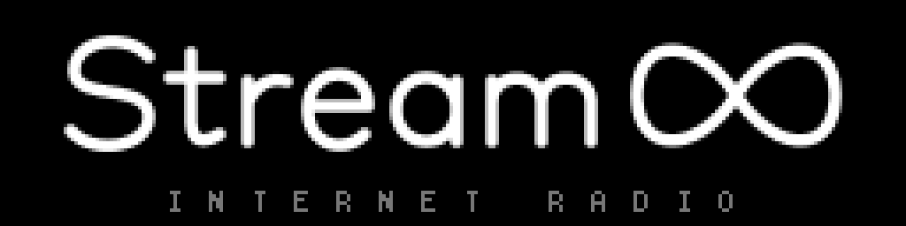

# 04 — OLED, Text and Visualizations

[English index](00_INDEX.md)

The SSD1322 display is 256×64 with 16 grayscale levels. A complete 4bpp framebuffer
occupies 8192 bytes. The project uses its own clipped renderer rather than LVGL.
Widgets draw within their assigned bounds using immutable snapshots; they do not
write directly to the display or fetch audio/network data.

## Screen layout and behavior

| Vertical area | Content |
| --- | --- |
| y=0–15 | Station name in the larger font |
| y=16–23 | Broadcast title/metadata |
| y=24–31 | Dim IP address, bright volume number and volume bar |
| y=32–63 | Audio/Wi-Fi information on the left, visualization in the center, date/clock on the right |

Long text scrolls from right to left. Old station metadata is cleared when the
session changes. The list uses vertical animation and highlights its central
selection; merely browsing does not interrupt the current stream. See
[encoder behavior](05_ENCODER.md).

The UI has an approximately 25 FPS update cadence. SPI transfers occur only when
pixels change, covering the range between the first and last changed rows.
Unchanged frames do not cause a transfer. Initial presentation and wake-up send
a complete image. UI frame rate and OLED panel scan timing are different quantities;
changing animation cadence is not proof of correcting electrical flicker.

## Boot and STOP

The logo appears after power-on/reset for at least 1.5 seconds and remains during
network/autoplay startup until playback or an appropriate setup/diagnostic screen.
It is not replayed on PLAY, reconnect or station changes. STOP turns off the panel
without shutting down the CPU or web interface. PLAY wakes it. AP setup remains
visible and does not run audio.

This is the existing renderer preview, not a photograph of the physical display.
The shared wordmark geometry is generated by `tools/generate_brand_mark.py` into
the web SVG and an OLED 4bpp mask. No new image or logo is required to build firmware.

## Fonts

The larger font is StreamOO UI16, generated from Monaspace Krypton under SIL OFL 1.1.
Small text uses the public-domain Misc Fixed Unicode 5×8 subset, including ASCII
and 18 Polish letters, in the existing 6×8 cell. The current small font replaces
the old provisional font with unresolved provenance. The user accepted its appearance
while noting that it was smaller and less readable.

Generated font data keep upstream terms; original rendering code is MIT.
See [license scope](LICENSING.md) and the source/generator records in
[assets/fonts/](../../assets/fonts/README.md).

## Visualization IDs

| Stored ID | View |
| --- | --- |
| 0 | Maximum-per-band spectrum |
| 1 | L/R RMS bargraphs with peak markers |
| 2 | L/R RMS needles with two-pixel peak markers |
| 3 | The same maximum spectrum with peak hold |

Both spectrum modes use checkerboard bars and −45…0 dBFS with gamma 2 height
mapping. Only ID 3 adds held, slowly falling peaks. ID 3 is no longer the former
experimental RMS spectrum. Existing preference records select the current view
without a storage migration. See [DSP behavior](07_DSP.md) for calculations and timing.

## Validation

Host tests cover clipped drawing, glyph mapping, text layout, list animation,
home snapshots and framebuffer comparisons. They cannot establish OLED brightness,
scan stability or real-world readability. Test these on the actual panel after
changes to fonts, timings, wiring or display behavior.
